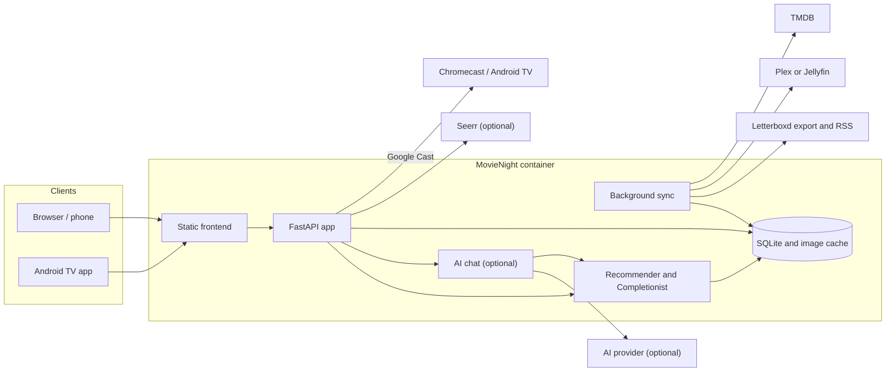

<div align="center">

# 🎬 MovieNight

**"What do I watch tonight?" — answered from your own library and your own taste.**

[](https://github.com/andreub/movienight/actions/workflows/release.yml)


</div>

MovieNight ranks the movies available on your **Plex** servers (or your **Jellyfin** server, see
[Media server](#feature-guides)) using your **Letterboxd** history (watched films, ratings,
likes, watchlist) and **TMDB** metadata, then suggests what to put on tonight.
It is a single-user app. With Plex, sign-in with the Plex account it belongs to is on by default; with
Jellyfin, sign-in is OIDC or switched off (see [Login](#login)). Without a login, run it only on a private
network.

## Features

- 🎯 **Tonight's pick and Browse**: taste-ranked recommendations from your library, with moods, length and watchlist filters.
- 📥 **Letterboxd import**: export folder or ZIP upload as the baseline, plus new diary entries from the public RSS feed.
- 🏷️ **Letterboxd tags as reference groups**: "Like my Sitges 2025" style filters.
- 🎞️ **Plex or Jellyfin**: one media server at a time; Plex PIN login, Jellyfin user and password from the environment.
- 👍 **Votes and "seen it" marks**: teach the recommender about films you never rated; optionally pushed back as played on the media server.
- 🧩 **Completionist**: sagas, franchises, series, canonical lists (Oscars Best Picture, Sight and Sound 2022), directors and actors, with what is left to watch.
- 🙋 **Seerr requests** (optional): request missing films through Overseerr or Jellyseerr with your own account.
- 📺 **Play on your TV**: Google Cast to Chromecasts and Android TVs (Plex).
- 🤖 **Android TV app**: a separate app loads this UI; D-pad navigation built in.
- 💬 **AI chat** (optional): ask for "something like..." and get films from your library (Anthropic or any OpenAI-compatible endpoint).
- 🔐 **Login options**: Plex, OpenID Connect (PKCE) or none.
- 🚀 **Automatic releases and preview deploys**: versioned multi-arch images, DB backup before every deploy, branch/PR previews.
- 🪶 **Light stack**: FastAPI + SQLite, a vanilla JS frontend with no build step, a hardened non-root read-only container.

## Table of contents

- [How it gets data](#how-it-gets-data)
- [Architecture](#architecture)
- [Quick start](#quick-start)
- [Configuration](#configuration)
- [Feature guides](#feature-guides): votes, tags, Completionist, TV, media server, Letterboxd refresh
- [Login](#login) · [AI chat](#ai-chat-optional) · [Privacy](#privacy) · [Health](#health)
- [Releases and deployment](#releases-and-deployment)
- [Testing](#testing)
- [Project layout](#project-layout)

## How it gets data

- **Letterboxd**: a data export (folder or ZIP upload) is the baseline for watched, rated,
  liked and watchlist films, and for diary tags (see below). New diary entries are picked up
  automatically from the public RSS feed.
- **Plex**: connect with a PIN login (plex.tv). Movie libraries from every server you own or
  have been shared are indexed; the first reachable connection is used.
- **Jellyfin** (instead of Plex): user name and password from the environment; the movies that
  account can see are indexed.
- **TMDB**: metadata (genres, cast, crew, keywords, posters, ratings) and recommendations.
  Responses are cached forever in the local database.

## Architecture



The sync job runs every `MOVIENIGHT_SYNC_HOURS` hours (default 6) and on demand. Everything the UI shows
comes from the local SQLite database; TMDB responses are cached there.

## Quick start

<details open>
<summary><b>Docker (compose)</b></summary>

```sh
cp .env.example .env          # optional: fill in TMDB token, Letterboxd username
mkdir -p data letterboxd      # put your unpacked Letterboxd export in ./letterboxd if you have one
docker compose up -d --build
```

Open http://localhost:8080 and connect Plex in Settings (with Jellyfin, set its variables instead).

</details>

<details open>
<summary><b>Local development (uv)</b></summary>

```sh
uv sync
uv run uvicorn movienight.app:app --reload --port 8080
uv run pytest
```

The UI can run without a backend in mock mode at http://localhost:8080/?mock=1.

</details>

## Configuration

<details>
<summary><b>Environment variables</b></summary>

| Variable | Default | Meaning |
|---|---|---|
| `MOVIENIGHT_DATA_DIR` | `./data` (`/data` in image) | SQLite database and image cache |
| `MOVIENIGHT_LETTERBOXD_DIR` | `./letterboxd` (`/letterboxd` in image) | Unpacked Letterboxd export, imported at start if present or changed |
| `MOVIENIGHT_LETTERBOXD_USER` | empty | Username for RSS sync; empty = read from `profile.csv` |
| `MOVIENIGHT_TMDB_TOKEN` | empty | TMDB v4 bearer token (`eyJ...`) or v3 API key; empty = degraded mode |
| `MOVIENIGHT_MEDIA_SERVER` | `plex` | `plex` or `jellyfin`: where the library comes from (one at a time; any other value stops the app at start) |
| `MOVIENIGHT_PLEX_TOKEN` | empty | Plex only: optional pre-set Plex token (otherwise PIN login in the UI) |
| `MOVIENIGHT_JELLYFIN_URL` | empty | Jellyfin only: server URL as opened in the browser, e.g. `https://jellyfin.example.com` |
| `MOVIENIGHT_JELLYFIN_USER` / `_PASSWORD` | empty | Jellyfin only: the account MovieNight signs in with |
| `MOVIENIGHT_JELLYFIN_WATCHED` | on | `0`: ignore what was played in Jellyfin (use it when the account is shared with other people) |
| `MOVIENIGHT_SYNC_HOURS` | `6` | Background sync interval |
| `MOVIENIGHT_PLEX_HISTORY_FIX` | on | Plex only, with `MOVIENIGHT_PUSH_SEEN`: marking a film played on a server does not make it watched on plex.tv, so the film is also marked watched on plex.tv (Discover) with your account token; plex.tv then adds a "watched just now" history entry, which is set to the film's Letterboxd diary date, or removed when there is none (marks made in Movienight never use the time you clicked). Films pushed by older versions are settled once on the next sync. Unmarking also unmarks on plex.tv. Uses undocumented plex.tv APIs, best effort. `0`/`false`/`no` = off |
| `MOVIENIGHT_PLEX_HISTORY_PACE` | `6` | Seconds between plex.tv history writes (it rate-limits; slower is safer). When rate limited it waits the server's retryAfter, else 1, 2, 4, 8, 10 minutes, retrying the same film, and stops the batch if still limited; the next batch follows 30 minutes later while unsettled films remain |
| `MOVIENIGHT_LOG_LEVEL` | `INFO` | Level of the app's own log lines (`docker logs`): `DEBUG`, `INFO`, `WARNING`... |
| `MOVIENIGHT_PUSH_LETTERBOXD_BACKFILL` | off | Plex only, with `MOVIENIGHT_PUSH_SEEN`: films that become watched on Letterboxd after this was first run are also marked played on Plex, dated with their diary date (or with no history entry when there is none). The Letterboxd history that already existed on that first run is skipped. `1` opts in to pushing that older history too, 25 films per sync (and plex.tv paced), so it spreads over several syncs: switch it off again when done |
| `MOVIENIGHT_CAST_HOSTS` | empty | Plex only: IPs/hostnames (comma-separated) of Chromecasts / Android TVs to offer under Play on, for when they are not found automatically (see Play on your TV) |
| `MOVIENIGHT_PUSH_SEEN` | off | `1`/`true`/`yes`: marks films you flag "seen it" as played on the media server (writes to that account). `MOVIENIGHT_PLEX_PUSH_SEEN` is the older name and still works |
| `MOVIENIGHT_LOGIN` | `plex` (Plex), empty (Jellyfin) | Login methods, comma-separated: `plex`, `oidc`, or `none`. See [Login](#login) |
| `MOVIENIGHT_PLEX_OWNER` | empty | Plex login only: the account id, username or email allowed in; empty = the first sign-in (or the account of the stored token) |
| `MOVIENIGHT_COMPLETIONIST` | on | The Complete tab (sagas, franchises, series, lists, directors, actors). `0`/`false`/`no`: tab hidden, `/api/completions*` answers 404, and the sync skips the collection, collection-search, keyword and person-credit lookups |
| `MOVIENIGHT_SEERR_URL` | empty | Overseerr / Jellyseerr API base including `/api/v1` (e.g. `https://seerr.example.com/api/v1`): each user connects their own Seerr account through Plex to request films missing from the library (see Completionist). No API key; unset = feature hidden |
| `MOVIENIGHT_PUBLIC_URL` | empty | OIDC login only: the public URL of the app; the redirect is `<MOVIENIGHT_PUBLIC_URL>/login/callback` |
| `MOVIENIGHT_OIDC_ISSUER` / `_CLIENT_ID` | empty | OIDC login only: issuer URL (turns OIDC on) and public PKCE client id |
| `MOVIENIGHT_OIDC_ALLOWED_SUBS` | empty | OIDC login only: comma-separated `sub` claims allowed in; empty = anyone the provider signs in |
| `MOVIENIGHT_AI_*`, `ANTHROPIC_API_KEY` | empty | Optional AI chat: see [AI chat](#ai-chat-optional) |
| `MOVIENIGHT_PORT` | `8080` | Compose only: host port |
| `TZ` | see `docker-compose.yml` | Compose only: container timezone |

</details>

## Feature guides

<details>
<summary><b>🗳️ Votes and "seen it" marks</b></summary>

- **Votes** on a film (detail sheet, tonight's pick, browse cards): thumbs down (-1), thumbs up (1)
  and ❤ "a favourite" (2). A vote teaches the recommender about films you never rated on
  Letterboxd: the film counts as a synthetic history entry (signal ±0.6, 0.95 for a favourite,
  about a liked 5-star film) and gets a direct boost or penalty. A Letterboxd rating always wins:
  once a film is rated there, its vote is ignored.
- **Seen it** marks a film as already watched here (not on Letterboxd): it stops showing up in your
  picks. On its own the mark is neutral; it teaches nothing about taste.
- **Seen these?** (`#/seen`) lists popular older films you probably know. Each card has four
  one-tap verdicts: 👎 seen, didn't like it · ✓ seen, no opinion · 👍 seen, liked it · ❤ a
  favourite. One tap saves the mark and the vote together (`POST /api/movies/{id}/seen` with
  `{"seen": true, "vote": 2}`); tapping the chosen verdict again removes both. The "Already
  marked" tab (`GET /api/seen-marked`, newest mark first) lets you rate films marked earlier.
- Films outside the library can be marked too, from the Complete tab (`POST /api/films/{tmdb_id}/seen`,
  same body): the mark and vote wait under `tmdb:<id>` and apply when the film reaches the library.
- With `MOVIENIGHT_PUSH_SEEN` on, marks are also set as played on Plex or Jellyfin, whichever way they are
  made. Only items the app marked itself are ever set back to unplayed.

</details>

<details>
<summary><b>🏷️ Letterboxd tags</b></summary>

Tags on diary entries (`diary.csv` and `reviews.csv` of the export, comma-separated, compared in lower
case) are stored per entry. A tag ending in a 4-digit year is an edition of a family: `sitges2024`,
`sitges2025` and `sitges 2026` all belong to `sitges`; a tag without a year is its own family.

Tagged films are already watched, so a tag is a reference group, not a filter on them: "films like
the ones I tagged X".

- **Tonight / Browse**: a "Like my …" chip per family next to the moods; once picked, a second row
  offers its editions. The filter keeps the quarter of the library most similar to the group (at
  least 40 films) and ranks it by your taste plus 1.5x that similarity, computed with the same
  affinity tables, idf weights and TMDB recommendations as the taste score. It combines with moods,
  length, watchlist and the seen/hidden exclusions. API: `tag=sitges2025` or `tag_family=sitges` on
  `/api/recommendations` and `/api/pick`; `GET /api/tags` lists the groups that can be used (at least
  3 films with TMDB details).
- **Taste**: per family and edition, number of films, mean rating of the entries and top genres
  (`tags` in `/api/profile`).
- **Ask**: the chat has a `list_tags` tool and a `tag` parameter on `search_library` ("something like
  what I saw at Sitges 2025").

The RSS feed carries no tags, so new tags arrive with the next export.

</details>

<details>
<summary><b>🧩 Completionist</b></summary>

The **Complete** tab lists the sagas, franchises and series you have started (at least one film
seen), the canonical lists you have dipped into, then the directors and actors you keep coming back to, with your progress ("4 of 9 seen") and what is left. Each film is **seen** (Letterboxd, played
on the media server, or marked seen here), **available** (in the library and unwatched: tap it to
open the film) or **missing** (not in the library, greyed out).

Nothing is hand-written: groups are discovered from your own data and the TMDB cache. The
exception is the canonical lists, which ship with the app.

- **Sagas**: the TMDB collection a seen film belongs to.
- **Franchises**: collections merged when one's stem names the others and most of their films
  ("Spider-Man", from the Raimi collection, names the Amazing, MCU and Spider-Verse collections).
  Siblings are found with a collection search on the stem. Collections with a far less popular
  offshoot (TV films, animated spin-offs), a name without the stem (Venom) or a generic stem
  ("Before", "Matrix") are not merged.
- **Orphans**: films in no TMDB collection join the started saga or franchise whose name opens their title or follows
  a colon (Rogue One: A Star Wars Story), or that carry a keyword named like it on few films (Bumblebee), in release
  order. Animated films (unless the saga is), TV films, documentaries, shorts, same-name remakes, films in another
  collection and films with under a fifth of the saga's median votes (half, for a keyword alone) stay out.
- **Series** (shown as sagas, under the Sagas chip): a TMDB keyword on a seen film whose name ends in a series word, such as
  `cornetto trilogy`, expanded to its films with TMDB's discover. Generic keywords ("trilogy",
  "family saga") and keywords on more than 20 films (themes, not series) are skipped. Entries with
  fewer than 20 votes (shorts, fan films) are dropped. A series whose films are all in a saga is
  not shown twice. A saga inside a series gives way to the series.
- A director's ordinary filmography, with recurring cast and themes, never becomes a saga. Some
  trilogies have no shared collection or keyword on TMDB (Park Chan-wook's Vengeance trilogy, for
  example), so they do not show up.
- **Lists**: canonical lists bundled in `src/movienight/data/lists/` (every Academy Award Best
  Picture winner; the Sight and Sound 2022 critics' poll top 100, with its ranks). A list shows once
  you have seen one of its films (on Letterboxd, on the media server or marked seen here, in the
  library or not) and goes to Completed when you have seen them all. No TMDB call at runtime: each
  file already carries the TMDB ids, posters, votes and genres. Lists have no order of their own and
  are presented like filmographies (below).
  - To add or refresh one, keep its `title`, `year`[, `rank`][, `tmdb_id`] TSV in `scripts/lists/`
    and run `MOVIENIGHT_TMDB_TOKEN=... uv run python scripts/build_list.py scripts/lists/<key>.tsv
    --key <key> --name "<name>"`. Each row must match TMDB's title and year (±1); anything less
    exact is printed for review and can be pinned with the `tmdb_id` column.
- **Directors**: someone who directed at least 3 films you have seen. **Actors**: someone billed in
  the top 5 of at least 4 films you have seen. The 40 of each with the most films seen are looked
  up. A person who qualifies as both shows only as a director.
  - Their films leave out documentaries, TV films, unreleased films and films with fewer than 100
    votes on TMDB. A film you have seen always stays, even when it fails these filters.
  - An actor's group holds at most 30 films: every seen one, then the most relevant unseen ones
    (in your library first).
  - A filmography shows only while it has at least one film seen and one to see.
  - Filmographies have no order of their own. Their cards list the films to see first: those in your
    library, then the missing ones by relevance (TMDB votes × rating, nudged by your taste for their
    genres). The seen ones fold into one "✓ N seen" tile at the end. The card shows the person's
    TMDB photo, or their initials when TMDB has none.
- **Cards**: posters fill the card's width. A saga shows every film in release order, seen ones
  dimmed with a ✓, so you see where the gaps are. When it doesn't fit in about three rows, runs of
  seen films fold into a "✓ 7 seen" tile (tap to open it). Unseen films and their neighbours always
  stay visible, and "Show all" appears only if the card still overflows. Finished groups and hidden
  ones (the × on a card, with undo) stay folded at the bottom.
- **Order**: each group gets a score, and one quiet hint on its card says why ("New 2026: Title",
  "You rated ★4.4", "In your library"). In "All", sagas (keyword series included) and franchises come
  first, then the lists, then directors and actors, each block ordered by score.
  `score = 3 × recency + 1.5 × taste + 0.75 × library + 0.5 × share seen`.
  - *Recency* is 1 when an unseen film came out in the last 18 months, fading to 0 at 5 years.
  - *Taste* compares your ratings of the group's seen films (Letterboxd; an app vote when there is
    no rating) with your overall mean. The mean is shrunk towards your overall mean as if two more
    films had been rated at it, so a single rating counts for little.
  - *Library* is 1 when an unseen film is playable now.
- **Android TV**: in the TV app the tab shows one group per screen, in the look of Tonight: the
  backdrop of the next film to watch, the name, progress, the hint and the whole saga as a poster
  row. Left and right move through the films, OK opens the side panel of any of them, down and up
  go to the next and previous group.
- **Kind chips** (All, Sagas, Franchises, Lists, Directors, Actors) filter both layouts. A chip whose
  kind has no group is hidden, and the browser remembers the choice. In Screen they sit at the top,
  beside the layout toggle, on one line that scrolls sideways on phones. Picking one starts over at
  the first group of that kind ("1 of N"). On the TV, Up on the first group moves to the chips
  (dimmed until then), Left and Right walk them, OK applies one and Down goes back to the films.
- **List / Screen toggle**: in a browser, a toggle in the tab's header switches between the cards
  (List, the default) and that one-group-per-screen layout (Screen: click a film, arrow keys and
  Enter, the arrows by the dots, the wheel or a vertical swipe change group); the browser remembers
  the choice. The TV app always shows Screen, without the toggle.
- **Any film opens a panel**, seen, in the library or missing. A film in the library to watch opens
  the usual detail sheet (Play lives there). Any other one opens a lighter panel built from TMDB
  (title, year, poster, overview; details are fetched once on demand when not cached):
  - **Not seen**: the four verdicts of "Seen these?" (👎 · ✓ · 👍 · ❤). The mark and the vote are
    stored under `tmdb:<id>`, like every seen mark and vote, so a film outside the library counts as
    seen in its saga at once and, when it later arrives in the library, it is seen there too and the
    vote teaches the recommender. Until then the vote already counts for the saga's taste score.
  - **Marked seen here**: the verdict can be changed, or "Unmark as seen" removes the mark and vote.
    If `MOVIENIGHT_PUSH_SEEN` had set it played on Plex or Jellyfin, that is undone too, at once.
  - **Seen on Letterboxd** or **seen on Plex/Jellyfin** (played there, not by MovieNight): shown as
    such, with no unmark. It can only be unmarked where it was logged or played.
- **Elsewhere in the app**:
  - **Detail sheet**: a film in a started saga or list shows one quiet line per group, e.g. "Part of
    Star Wars · 4 of 11" (two at most, best first; a director's or actor's films only when it is in
    neither). The line opens that group on Complete (`#/complete?group=<key>`): scrolled to, a saga
    unfolded in full. `/api/movies/{id}` and `/api/films/{tmdb_id}` return it as `groups`.
  - **Tonight**: a "Complete a saga" chip beside Watchlist only suggests the next film of each started
    saga that is in your library, each naming its saga ("Next in Before · 1 of 3 seen"). It shows only
    when there is such a film (`/api/pick?complete=true`; `saga_count` in every pick).
  - **Ask**: the assistant's `list_completions` tool lists the groups in progress, with progress and
    the next films to watch (in the library first), optionally of one kind.
- **Requests (Seerr, optional)**: with Overseerr or Jellyseerr set up (`MOVIENIGHT_SEERR_URL`, its API base,
  e.g. `https://seerr.example.com/api/v1`), each user connects **their own** Seerr account: Setup → Sync →
  *Seerr* → **Connect Seerr**. There is no API key: MovieNight asks plex.tv for a PIN, the user approves it on
  app.plex.tv, and the Plex token that comes back is handed straight to Seerr (`POST /auth/plex`). MovieNight keeps
  only Seerr's session cookie for that user (`seerr_sessions`, never the Plex token), so requests carry the user's
  own Seerr permissions and approval rules. The line then reads *<name> · Disconnect*, or *Session expired ·
  Reconnect Seerr* once Seerr stops accepting the session.
  - Connected users get **Request** in place of the disabled Play in the panel of a film missing from the library,
    then a quiet chip: *Requested* (pending or approved in Seerr) or *Available soon* (Seerr has it; it appears in
    the library after the next sync). Missing posters on Complete (List and Screen) carry the same state as a small
    badge. Users who have not connected see none of this.
  - States come from one paged read of `GET /media?take=100&skip=N&filter=all` (films only; Seerr status 2–3 =
    requested, 4–5 = available), cached per user for an hour and dropped after a request, connect or disconnect.
    A request is `POST /request` (`{"mediaType": "movie", "mediaId": <tmdb>}`); one already requested (409)
    counts as requested.
  - API (all per signed-in user): `GET /api/seerr/status` → `{"enabled", "connected", "expired", "name"}`;
    `POST /api/seerr/connect` → `{"url"}` (the app.plex.tv page; it forwards back to `/api/seerr/callback?pin=<id>`,
    which redirects to `/?seerr=connected` or `/?seerr=failed`); `DELETE /api/seerr/session` disconnects;
    `GET /api/seerr/statuses?tmdb=1,2,3` → `{"statuses": {"1": "requested"}}` (`none`, `requested`,
    `available`); `POST /api/seerr/request/{tmdb_id}` → `{"status": ...}`. 409 = not connected or the session
    expired (Reconnect), 403 = the Seerr account may not request films, 502/504 = Seerr unreachable.
  - PINs live in memory for 10 minutes and only complete for the user who started them. With login off
    (`MOVIENIGHT_LOGIN=none`) there is a single, local user.
  - With the variable unset nothing shows, `/api/seerr/status` answers `{"enabled": false}`, every other
    `/api/seerr/*` route answers 404 and `features.seerr` in `/api/status` is `false`.
- **Off switch**: `MOVIENIGHT_COMPLETIONIST=0` hides the tab (browser and TV), answers 404 on every
  `/api/completions*` route, drops the detail line, the Tonight chip and the chat tool, and skips the
  TMDB lookups above (`features.completionist` in `/api/status` tells the frontend).
- **Data**: the TMDB sync stores each film's collection, keyword ids and director/cast ids with its
  details (details stored before these fields existed are backfilled once). It then caches, for 30
  days:
  - the collection searches (`tmdb_lookups`);
  - the collections (`tmdb_collections`), with each film's backdrop (collections cached before
    backdrops were kept are refetched once);
  - the films of each series keyword (`tmdb_lookups`);
  - the film credits of each eligible director and actor (`tmdb_person_credits`, one
    `/person/{id}?append_to_response=movie_credits` call per person, at most 80 per sync, none when
    nothing is stale).
- **API**:
  - `GET /api/completions?kind=collection (also the keyword series)|franchise|series|list|director|actor&hidden=true` returns the
    groups with `films` (each with its `state`), `ordered`, `seen`, `total`, `available`, `next`,
    `score`, `reason` and `backdrop_url`: sagas first, then lists, then people, each block best score
    first. Sagas are `ordered` (the whole group in release order); filmographies and lists are not
    (films to see first, ranked, then the seen ones). Filmographies add `person_id` and `profile_url`;
    films of a ranked list carry their `rank`.
  - `GET /api/completions/{key}` returns one group.
  - `POST` and `DELETE /api/completions/{key}/hide` hide and unhide a group.
  - `GET /api/films/{tmdb_id}` returns a film by TMDB id, in the library or not, with `seen_via`
    (`letterboxd`, `server`, `here`), `can_unmark`, `my_vote` and `movie_id` when it is in the
    library. `POST /api/films/{tmdb_id}/seen` takes `{"seen": true, "vote": 2}` like the library
    route; unmarking a film seen on Letterboxd or played on the server answers 409.
  - Keys look like `collection-556`, `franchise-spider-man`, `series-357318`,
    `list-oscars-best-picture`, `director-525` and `actor-6193`.

</details>

<details>
<summary><b>📺 Play on your TV</b></summary>

With Plex, the play button also lists the Chromecasts and Android TVs (anything with Google Cast built in) on
your network as "Play on <name>", so one click starts the movie there; "Open in Plex Web" stays in the menu.
MovieNight uses Google Cast, the same way the Plex phone app casts, because Plex removed remote control
("Advertise as player", Plex Companion) from its new apps.

- The container must reach the TV on TCP 8008 and 8009, and the TV must reach your Plex server on its LAN address.
- Devices are found over mDNS when the container has host networking (Linux). Docker Desktop on macOS cannot do
  multicast, so there the TVs are found through the device list of your Plex account (LAN IPs of your Plex
  players) or the `MOVIENIGHT_CAST_HOSTS` variable (comma-separated IPs or hostnames).
- The device name shown is the one the TV reports. Plex only.

Android TV: a separate app (repo movienight-androidtv) loads this UI; the UI detects the `MovieNightTV` user
agent and enables D-pad navigation (arrow keys move focus to the nearest control, Enter opens it, a larger focus
ring) and opens Plex links in the Plex app, as on phones.

</details>

<details>
<summary><b>🎞️ Media server: Plex or Jellyfin</b></summary>

`MOVIENIGHT_MEDIA_SERVER` picks one: `plex` (default) or `jellyfin`. The app never reads both.

**Jellyfin** needs `MOVIENIGHT_JELLYFIN_URL`, `MOVIENIGHT_JELLYFIN_USER` and
`MOVIENIGHT_JELLYFIN_PASSWORD`. Settings then shows a read-only Jellyfin card (account, film count,
any problem, "Sync now"); there is no connection form. MovieNight signs in once
(`POST /Users/AuthenticateByName`), keeps the access token in its database and signs in again only if
the server rejects it. The password is read from the environment and never stored, logged or returned
by the API. What the account played in Jellyfin counts as watched (`MOVIENIGHT_JELLYFIN_WATCHED=0`
turns that off), "Play on Jellyfin" opens the film in the Jellyfin web app, and with
`MOVIENIGHT_PUSH_SEEN` on, "seen it" marks are set as played there. If the account is shared with
other people, set `MOVIENIGHT_JELLYFIN_WATCHED=0` and leave `MOVIENIGHT_PUSH_SEEN` off: its played
state is not only yours. Written against the Jellyfin 12.4 API documentation (the endpoints also exist
in 10.8-10.11); played/unplayed falls back to the older path of Jellyfin 10.8.

**Switching** an existing database from one type to the other deletes, once at start, the stored
library, its servers, the films you hid ("not tonight") and the old type's settings (e.g. the stored
Plex token), plus the image cache. Seen marks, votes, Letterboxd data, tags and TMDB data are keyed by
TMDB id and stay. Marks already pushed to the old server stay on that server.

The database tables are `media_servers` and `media_items` since schema version 7 (they were
`plex_servers` and `plex_items`). Older versions of MovieNight cannot open a database after that
upgrade: `scripts/deploy.sh` backs up the database automatically before every deploy (see Deploy), and
you roll back by restoring that copy together with the previous code.

</details>

<details>
<summary><b>🔄 Refreshing Letterboxd data</b></summary>

1. On letterboxd.com go to Settings, then Data, then Export, and download the ZIP.
2. In MovieNight open Settings and upload the ZIP (or unpack it into the Letterboxd folder: it is
   imported at start when its files change).

Between exports, new diary entries arrive through RSS automatically (without their tags).

</details>

## Login

With Plex the default is "Sign in with Plex": only the Plex account the app belongs to gets in
(`MOVIENIGHT_PLEX_OWNER`, or the first sign-in). On a TV, "Sign in with a code (TV)" shows a 4-character
code to enter at plex.tv/link on a phone that is already signed in to Plex (same account check, no typing on the TV). With Jellyfin there is no Jellyfin login: use OIDC
(below), or `MOVIENIGHT_LOGIN=none` on a private network. With Jellyfin and neither, the app answers
503 instead of running open; `MOVIENIGHT_LOGIN=plex` with Jellyfin stops the app at start.

Set `MOVIENIGHT_OIDC_ISSUER`, `MOVIENIGHT_OIDC_CLIENT_ID` and `MOVIENIGHT_PUBLIC_URL` to require a
login through an OpenID Connect provider (Pocket ID, Authelia, Keycloak…). Create a **public client
with PKCE** there, with the redirect `<MOVIENIGHT_PUBLIC_URL>/login/callback`.
`MOVIENIGHT_OIDC_ALLOWED_SUBS` (comma-separated `sub` claims) limits who gets in. With an issuer but
no client id the app answers 503: it never runs open by accident. Sessions last 30 days.

## AI chat (optional)

<details>
<summary><b>Providers, budget and example</b></summary>

An "Ask" tab lets you describe what you feel like watching; an AI model answers with films from your
library, using tools that search the library, read film details and your taste profile. Two kinds of
provider work:

| Variable | Meaning |
|---|---|
| `MOVIENIGHT_AI_PROVIDER` | `anthropic` (default) or `openai` = any OpenAI-compatible endpoint (Groq, OpenAI, a local server…). Unset with `MOVIENIGHT_AI_BASE_URL` set means `openai`. |
| `ANTHROPIC_API_KEY` | key for `anthropic` (`MOVIENIGHT_AI_MODEL` defaults to `claude-opus-5-5`) |
| `MOVIENIGHT_AI_BASE_URL` | `openai` only, e.g. `https://api.groq.com/openai/v1` |
| `MOVIENIGHT_AI_API_KEY` | `openai` only: the provider's key |
| `MOVIENIGHT_AI_MODEL` | model id; required for `openai` (no default). The model must support streaming tool calls. |
| `MOVIENIGHT_AI_PRICE_INPUT` / `_OUTPUT` | `openai` only: USD per 1M tokens for the spend estimate; default `0` (free tier) |
| `MOVIENIGHT_AI_MAX_TOKENS` | `openai` only: reply cap per request, default `2048` (free tiers meter tokens per minute) |

The chat stays hidden until the chosen provider is fully configured; `GET /api/chat/status` names the
missing variable (never a value). Example for Groq's free tier:

```sh
MOVIENIGHT_AI_PROVIDER=openai
MOVIENIGHT_AI_BASE_URL=https://api.groq.com/openai/v1
MOVIENIGHT_AI_API_KEY=gsk_...
MOVIENIGHT_AI_MODEL=openai/gpt-oss-120b
```

A free tier's own limits are the real cap there (Groq's free plan for that model: 30 requests/minute,
1,000/day, 8K tokens/minute, 200K/day as of 2026-11; one question takes 2-5 requests). When they are hit,
the chat says so and you try again later.

A monthly spending quota protects your tokens: `MOVIENIGHT_AI_MONTHLY_BUDGET_USD` (default `2.00`, `0` = no
limit). Usage is counted per UTC month and priced from list prices (Claude models) or the
`MOVIENIGHT_AI_PRICE_*` values (other models), so it is an estimate, not the invoice. With price `0` it
never trips; the usage line then shows questions and tokens only. Once the budget is reached, new
questions get a short "budget used" reply (no API call) until the 1st. A hard cap can also be set on the
provider's console.

</details>

## Privacy

Your Letterboxd export and the Plex token or Jellyfin access token are stored only in the local data
volume (`./data`); the Jellyfin password stays in the environment. Nothing is sent anywhere except the
Letterboxd RSS feed, plex.tv and your Plex servers (with Plex), your Jellyfin server (with Jellyfin),
TMDB and, if you enable the chat, the configured AI provider. Each chat question sends it your taste profile (top
genres, directors, cast, your highest-rated and recently watched titles), titles and details from your
library, and the conversation itself. Free tiers may keep or use that data on their own terms: read the
provider's data policy before you turn the chat on. Without the optional login, keep the service on a private
network (VPN or a reverse proxy with access control).

## Health

`GET /healthz` returns `{"ok": true}`. The container health check uses the same endpoint.

## Releases and deployment

<details>
<summary><b>Releases (versioning)</b></summary>

Every push to `main` publishes a new version: a `vX.Y.Z` git tag, a GitHub Release and a Docker
image (linux/amd64 and linux/arm64) at `ghcr.io/andreub/movienight`, tagged `X.Y.Z`, `X.Y`, `X`,
`latest` and `sha-<short>`. The GHCR package is private, like the repo.

The version comes from the title of the merged PR, which must follow Conventional Commits
(`type(scope): subject`; a PR check enforces it). If the push has no PR, the commit subject is used.

| Title | Bump |
| --- | --- |
| `type!: ...` or `BREAKING CHANGE:` in the PR body | major |
| `feat: ...` | minor |
| anything else (`fix`, `perf`, `refactor`, `docs`, `chore`, `ci`, `test`, `build`, `style`, `revert`) | patch |

The bump applies to the latest `vX.Y.Z` tag; with no tag yet the first release is `v1.0.0`. Tests
must pass before a release is cut.

</details>

<details>
<summary><b>Deploy, backups and preview deploys</b></summary>

Merging a PR to `main` runs the Release workflow (see Releases), which pushes
`ghcr.io/andreub/movienight:latest`. The home server runs that image and Watchtower pulls it on its
own schedule, so nothing else is needed.

To get it immediately, from a checkout at `origin/main`:

```sh
scripts/deploy.sh                       # HOST defaults to your ssh alias, see .deploy.env.example
CONTAINER=movienight-jf scripts/deploy.sh   # another instance running the same image
SKIP_WAIT=1 scripts/deploy.sh           # do not wait for the Release workflow
```

The script checks that `HEAD` is `origin/main`, waits for that commit's Release run, asks Watchtower
on the server to update the image (HTTP API `POST /v1/update?image=...`, token read on the server),
and waits up to five minutes until the container is healthy and its
`org.opencontainers.image.version` label matches the released version.

Settings (`HOST`, `CONTAINER`, `IMAGE`, `TAG_VAR`) can also live in a git-ignored `.deploy.env.local`
at the repo root; copy `.deploy.env.example`. Variables set in the environment win over the file.

#### Automatic database backup

Before it changes the container (a release, a preview, or the return to `latest`) the script backs up
the database inside the running container with SQLite's online backup API, so the copy is consistent
while the app writes, and checks it with `PRAGMA integrity_check`. The copy is
`movienight.db.bak-auto-<UTC time>-pre-<target>` next to the database; the newest `KEEP_BACKUPS` (5)
are kept and other files are never touched. If the backup fails the deploy stops; if the container is
not running it only warns. Settings: `DB_PATH` (default `/data/movienight.db`, a path inside the
container), `KEEP_BACKUPS`, and `NO_BACKUP=1` to skip it.

To restore: stop the container, copy the chosen `.bak-auto-*` file over `movienight.db`, delete
`movienight.db-wal` and `movienight.db-shm`, and start the container (on the matching code version).

#### Testing a branch or PR before merging

```sh
scripts/deploy.sh 12          # a PR number
scripts/deploy.sh feat/x      # or a branch name
scripts/deploy.sh             # from main: back to :latest
```

The script resolves the branch head on `origin`, dispatches the manual **Preview image** workflow
on `main` with the branch as its `ref` input, so branches cut before that workflow existed work too
(tests, then a multi-arch image of the branch head tagged `sha-<7>` and `branch-<name>`, never
`latest`, no release), unless that commit already has a successful Release run (a `main` commit).
Previews are always rebuilt. The script then recreates the container on `sha-<7>` through its
docker compose project and waits until it is healthy and its `org.opencontainers.image.revision`
label is the commit. `SKIP_WAIT=1` skips the build wait. Local `HEAD` differing from the branch, or
unpushed commits, only produce a warning: what gets deployed is `origin/<branch>`.

One-time change on the server: the compose file must take the tag from a variable, so the script can
choose it (the variable name can be changed with `TAG_VAR`; the script refuses to deploy otherwise):

```yaml
image: ghcr.io/andreub/movienight:${MOVIENIGHT_TAG:-latest}
```

Notes:

- Watchtower does not move a preview: the container stays on its `sha-<7>` tag. Run
  `scripts/deploy.sh` with no argument from an up-to-date `main` to recreate it on `latest`.
- A preview runs against the same data volume as production. For a PR with migrations, take a
  database backup first (see above; the script makes one automatically).

</details>

## Testing

```sh
uv run pytest
```

pytest with `pytest-asyncio` (auto mode); the suite lives in `tests/` and covers the API, sync, recommender,
Completionist, Plex/Jellyfin/Seerr clients, login and chat. Tests must pass before a release is cut.

## Project layout

```
src/movienight/            FastAPI app (app.py), sync jobs (sync.py), SQLite storage (db.py)
  recommender.py           Taste scoring and recommendations
  completion.py            Completionist groups (sagas, lists, people)
  letterboxd.py, tmdb.py   Letterboxd import/RSS and TMDB client
  plex.py, jellyfin.py     Media server clients (servers.py picks one)
  seerr.py, cast.py        Seerr requests, Google Cast playback
  auth.py, chat.py         Login (Plex / OIDC) and the optional AI chat
  static/                  Vanilla JS/CSS frontend (no build step)
  data/lists/              Bundled canonical lists for Completionist
tests/                     pytest suite
scripts/deploy.sh          Deploy / preview deploy to your server
scripts/build_list.py      Builds a canonical list from scripts/lists/*.tsv (dev only, needs a TMDB token)
.github/workflows/         Release, Preview image, PR title check
Dockerfile                 Non-root image, read-only root filesystem at runtime
docker-compose.yml         Local run with a private data volume
```
